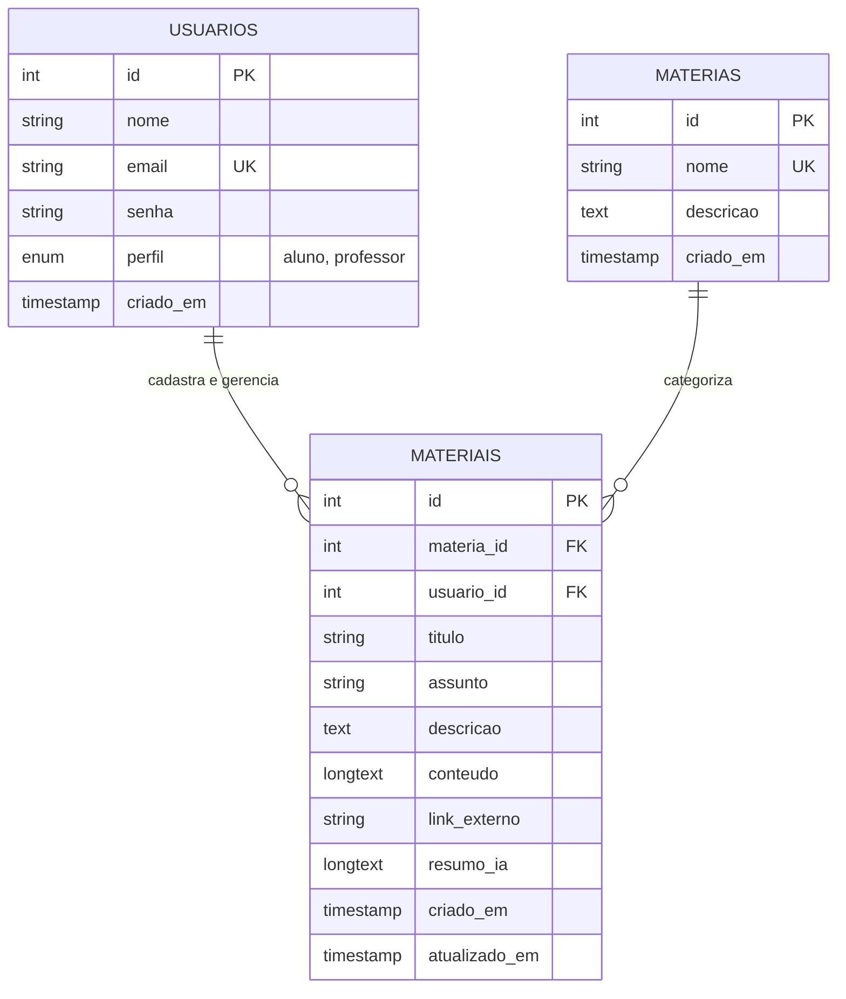

# SPEC.MD — Especificação de Requisitos e Arquitetura do Sistema Aula+

**Projeto Acadêmico:** Curso Técnico em Informática — Instituto Federal de Rondônia (IFRO)  
**Sistema:** Aula+ — Simplificar o Estudo  
**Status do Documento:** Especificação Validada / Aprovada para Desenvolvimento  
**Versão:** 1.0.0  

---

## 1. Objetivo

O **Aula+** é um sistema web desenvolvido para centralizar, organizar e facilitar a localização de materiais de estudo dispersos em diferentes plataformas e formatos. A plataforma é destinada a alunos e professores do Instituto Federal de Rondônia (IFRO), permitindo que conteúdos educacionais sejam catalogados e encontrados rapidamente por matéria, título e assunto. Além do gerenciamento de conteúdos, o sistema integra de forma complementar a geração de resumos automatizados por Inteligência Artificial para otimizar a revisão dos estudantes sem comprometer a disponibilidade dos materiais caso a IA esteja offline.

---

## 2. Usuários

O sistema possui dois perfis de usuários distintos, com níveis de acesso e autorizações estritamente verificados no servidor:

### 2.1. Aluno
* **Descrição:** Estudante que utiliza o sistema para localizar conteúdos, revisar assuntos e consumir materiais de apoio ao aprendizado.
* **Ações permitidas:**
  * Realizar cadastro informando dados pessoais (nome, e-mail, senha) com perfil "aluno".
  * Autenticar-se no sistema (login) e encerrar a sessão (logout).
  * Visualizar a lista de matérias cadastradas.
  * Consultar e filtrar materiais de estudo por matéria, título, descrição ou assunto.
  * Visualizar os detalhes completos de qualquer material de estudo (descrição, notas de aula, links de referência).
  * Visualizar o resumo gerado por IA associado a um material de estudo.
  * Acionar a geração de resumo por IA para um material que ainda não possua resumo gerado.
* **Ações restritas (proibidas):**
  * Não pode cadastrar, editar ou excluir matérias.
  * Não pode cadastrar, editar ou excluir materiais de estudo.

### 2.2. Professor
* **Descrição:** Docente responsável por organizar disciplinas e disponibilizar materiais didáticos para as turmas.
* **Ações permitidas:**
  * Todas as ações permitidas ao Aluno.
  * Realizar cadastro informando dados pessoais com perfil "professor".
  * Cadastrar novas matérias no sistema (nome e descrição).
  * Cadastrar novos materiais de estudo associados a uma matéria existente, vinculando a autoria ao seu próprio ID de usuário.
  * Editar materiais de estudo previamente cadastrados por ele mesmo.
  * Excluir materiais de estudo de sua autoria após confirmação explícita.
  * Solicitar ou regenerar resumos de seus materiais via Inteligência Artificial.
* **Ações restritas (proibidas):**
  * Não pode alterar ou excluir materiais criados por outros professores.
  * Não pode ter sua permissão de docência burlada via manipulação de parâmetros no front-end.

---

## 3. Casos de Uso Principais

* **UC01 — Cadastrar Usuário:** Permite que uma pessoa se registre no sistema como aluno ou professor.
* **UC02 — Autenticar Usuário (Login):** Valida credenciais (e-mail e senha) e inicia uma sessão autenticada segura.
* **UC03 — Encerrar Sessão (Logout):** Finaliza a sessão ativa do usuário no servidor e limpa os cookies de sessão.
* **UC04 — Cadastrar Matéria:** Permite que um professor cadastre uma nova matéria no catálogo.
* **UC05 — Listar Matérias:** Exibe todas as matérias cadastradas para navegação e filtragem.
* **UC06 — Cadastrar Material de Estudo:** Permite que um professor adicione um material vinculado a uma matéria, especificando título, assunto, descrição, conteúdo e link de referência.
* **UC07 — Consultar e Buscar Materiais:** Permite que alunos e professores busquem conteúdos por texto livre (título, descrição, assunto) e por seleção de matéria.
* **UC08 — Editar Material de Estudo:** Permite que o professor autor atualize as informações de um material cadastrado por ele.
* **UC09 — Excluir Material de Estudo:** Permite que o professor autor remova um material de sua autoria com confirmação prévia.
* **UC10 — Gerar Resumo com Inteligência Artificial:** Aciona serviço auxiliar de IA para resumir o conteúdo do material de forma assíncrona/resiliente.

---

## 4. Requisitos Funcionais (RF)

| ID | Descrição do Requisito Funcional | Caso de Uso Vinculado | Verificação |
| :--- | :--- | :--- | :--- |
| **RF01** | O sistema deve permitir o cadastro de novos usuários com os campos obrigatórios: Nome Completo, E-mail (único), Senha e Perfil (`aluno` ou `professor`). | UC01 | Teste de inserção com dados válidos, e-mail duplicado e campos em branco. |
| **RF02** | O sistema deve autenticar o usuário validando o e-mail e a senha fornecidos contra os registros do banco de dados, estabelecendo uma sessão de usuário. | UC02 | Teste de login com credenciais corretas, incorretas e inexistentes. |
| **RF03** | O sistema deve permitir o encerramento da sessão ativa do usuário, invalidando a sessão no servidor e redirecionando para a tela de login. | UC03 | Teste de logout e verificação de bloqueio ao tentar acessar rota restrita posteriormente. |
| **RF04** | O sistema deve permitir que usuários com perfil de professor cadastrem novas matérias informando nome (obrigatório e único) e descrição (opcional). | UC04 | Teste de cadastro por professor e tentativa de cadastro por aluno (bloqueio 403). |
| **RF05** | O sistema deve listar todas as matérias cadastradas, indicando a quantidade de materiais associados a cada uma. | UC05 | Teste de renderização da listagem com contagem de materiais. |
| **RF06** | O sistema deve permitir que professores cadastrem materiais de estudo contendo: Matéria associada, Título, Assunto, Descrição, Conteúdo textual e/ou Link externo. | UC06 | Teste de cadastro de material com validação de campos obrigatórios. |
| **RF07** | O sistema deve associar automaticamente o material cadastrado ao ID do usuário autenticado (professor autor). | UC06 | Verificação no banco de dados da coluna `usuario_id` preenchida com a sessão atual. |
| **RF08** | O sistema deve permitir a busca de materiais através de filtros combinados: termo textual (que busca em título, assunto e descrição) e seleção de matéria. | UC07 | Teste de busca com palavras-chave exatas, parciais e filtros vazios. |
| **RF09** | O sistema deve permitir que o professor autor edite os dados de seu material de estudo (título, assunto, descrição, conteúdo e link). | UC08 | Teste de edição pelo autor e tentativa de edição por outro usuário. |
| **RF10** | O sistema deve permitir que o professor autor exclua seu material de estudo mediante confirmação na interface. | UC09 | Teste de exclusão com modal de confirmação e verificação de remoção no banco. |
| **RF11** | O sistema deve oferecer um botão para gerar resumo por IA com base no conteúdo textual e descrição do material de estudo, armazenando o resultado gerado. | UC10 | Teste de chamada à API de IA e gravação do campo `resumo_ia`. |
| **RF12** | O sistema deve tratar falhas ou indisponibilidade da API de IA exibindo alerta informativo amigável, sem impedir o acesso e navegação pelo material. | UC10 | Simulação de timeout/erro HTTP na API de IA e teste de resiliência. |
| **RF13** | O sistema deve exibir mensagens claras de feedback (sucesso, erro ou alerta) após qualquer submissão de formulário ou operação crítica. | Todos | Teste de flash messages na interface após ações de formulário. |

---

## 5. Requisitos Não Funcionais (RNF)

| ID | Requisito Não Funcional | Detalhamento Técnico e Justificativa |
| :--- | :--- | :--- |
| **RNF01** | **Armazenamento de Senhas com Hash Seguro** | As senhas nunca devem ser salvas em texto puro. O sistema deve utilizar obrigatoriamente a função nativa `password_hash()` com algoritmo padrão (Bcrypt ou Argon2id) e a verificação estrita via `password_verify()`. |
| **RNF02** | **Validação Completa no Servidor** | Todos os formulários recebidos devem passar por validação rigorosa no servidor (sanitização de strings, validação de formato de e-mail com `filter_var`, limites de tamanho e verificação de tipos). A validação em JavaScript no front-end é apenas auxiliar. |
| **RNF03** | **Prevenção contra SQL Injection via PDO** | Toda interação com o banco de dados MySQL deve utilizar a extensão PDO com Prepared Statements e vinculação de parâmetros (`prepare` e `execute`). Consultas concatenadas com variáveis de usuário são terminantemente proibidas. |
| **RNF04** | **Proteção contra Cross-Site Scripting (XSS)** | Todo dado fornecido por usuários e renderizado em HTML deve ser tratado com `htmlspecialchars($valor, ENT_QUOTES, 'UTF-8')`. |
| **RNF05** | **Proteção contra Cross-Site Request Forgery (CSRF)** | Todos os formulários que realizam ações de mutação de dados (criação, edição, exclusão) devem incluir um token CSRF aleatório gerado por sessão e verificado no processamento POST. |
| **RNF06** | **Segurança de Gerenciamento de Sessão** | Utilização de `session_regenerate_id(true)` no momento da autenticação para evitar ataques de fixação de sessão. Cookies de sessão configurados com `httponly = true` e `samesite = 'Lax'`. |
| **RNF07** | **Tratamento Seguro de Exceções e Erros** | O sistema deve capturar exceções de banco (`PDOException`) e erros de rede, registrando-os em arquivo de log no servidor e exibindo ao usuário apenas mensagens amigáveis, sem expor caminhos, senhas ou queries SQL. |
| **RNF08** | **Desacoplamento e Resiliência da IA** | A integração com o serviço de Inteligência Artificial deve possuir timeout configurável (máx. 10s) e tratamento específico de erro, garantindo que o núcleo do sistema funcione 100% mesmo se a chave de IA não estiver configurada ou a rede estiver instável. |
| **RNF09** | **Interface Responsiva e Semântica** | O front-end deve ser construído em HTML5 semântico e CSS3 responsivo (compatível com mobile e desktop sem quebras de layout). |
| **RNF10** | **Compatibilidade e Ausência de Frameworks Pesados** | O back-end deve ser implementado em PHP 8.x puro, mantendo arquitetura simples, modular e diretamente executável no servidor Apache do XAMPP sem dependências externas complexas. |

---

## 6. Modelo de Dados (DER Simples)

### 6.1. Diagrama de Relacionamento de Entidades

### 6.2. Dicionário de Dados

1. **Tabela `usuarios`**
   * `id`: INT UNSIGNED AUTO_INCREMENT, Chave Primária.
   * `nome`: VARCHAR(120), NOT NULL — Nome completo do usuário.
   * `email`: VARCHAR(150), NOT NULL, UNIQUE — E-mail de acesso e identificação única.
   * `senha`: VARCHAR(255), NOT NULL — Hash criptográfico gerado por `password_hash()`.
   * `perfil`: ENUM('aluno', 'professor'), NOT NULL, DEFAULT 'aluno' — Papel de autorização do usuário.
   * `criado_em`: DATETIME / TIMESTAMP, NOT NULL, DEFAULT CURRENT_TIMESTAMP.

2. **Tabela `materias`**
   * `id`: INT UNSIGNED AUTO_INCREMENT, Chave Primária.
   * `nome`: VARCHAR(100), NOT NULL, UNIQUE — Nome da disciplina (ex: Programação Web, Banco de Dados).
   * `descricao`: TEXT, NULL — Detalhes dos tópicos abordados pela matéria.
   * `criado_em`: DATETIME / TIMESTAMP, NOT NULL, DEFAULT CURRENT_TIMESTAMP.

3. **Tabela `materiais`**
   * `id`: INT UNSIGNED AUTO_INCREMENT, Chave Primária.
   * `materia_id`: INT UNSIGNED, NOT NULL, Chave Estrangeira referenciando `materias(id)` com `ON DELETE RESTRICT`.
   * `usuario_id`: INT UNSIGNED, NOT NULL, Chave Estrangeira referenciando `usuarios(id)` com `ON DELETE RESTRICT` (Professor autor).
   * `titulo`: VARCHAR(180), NOT NULL — Título claro do material (ex: Resumo de Sintaxe PHP e PDO).
   * `assunto`: VARCHAR(120), NOT NULL — Tópico específico (ex: PDO, Arrays, Funções).
   * `descricao`: TEXT, NOT NULL — Breve resumo explicativo do que o material contém.
   * `conteudo`: LONGTEXT, NULL — Texto completo de estudo, apontamentos ou anotações.
   * `link_externo`: VARCHAR(255), NULL — URL complementar (ex: link do GitHub, slides ou artigo oficial).
   * `resumo_ia`: LONGTEXT, NULL — Conteúdo resumido gerado pelo recurso auxiliar de IA.
   * `criado_em`: DATETIME / TIMESTAMP, NOT NULL, DEFAULT CURRENT_TIMESTAMP.
   * `atualizado_em`: DATETIME / TIMESTAMP, NOT NULL, DEFAULT CURRENT_TIMESTAMP ON UPDATE CURRENT_TIMESTAMP.

---

## 7. Critérios de Aceite (Dado que / Quando / Então)

### CA01 — Cadastro de Usuário (RF01)
* **Cenário 1: Cadastro com dados válidos**
  * **Dado que** o visitante está na página de cadastro e preenche nome, e-mail não cadastrado, senha com mais de 6 caracteres e escolhe o perfil "aluno" ou "professor",
  * **Quando** ele submete o formulário,
  * **Então** o sistema deve armazenar o usuário com a senha criptografada em hash, exibir mensagem de sucesso e redirecioná-lo para a tela de login.
* **Cenário 2: Cadastro com e-mail já existente**
  * **Dado que** o visitante preenche o formulário com um e-mail já registrado,
  * **Quando** ele submete o formulário,
  * **Então** o sistema deve rejeitar o cadastro no servidor, manter o formulário preenchido (exceto senhas) e exibir mensagem de erro informando que o e-mail já está em uso.

### CA02 — Autenticação de Usuário (RF02)
* **Cenário 1: Login com credenciais válidas**
  * **Dado que** o usuário cadastrado informa seu e-mail e senha corretos,
  * **Quando** ele clica em "Entrar",
  * **Então** o sistema valida o hash com `password_verify()`, regenera o identificador da sessão, registra o usuário na sessão e o redireciona para o dashboard com mensagem de boas-vindas.
* **Cenário 2: Login com credenciais incorretas**
  * **Dado que** o usuário informa senha incorreta ou e-mail inexistente,
  * **Quando** ele clica em "Entrar",
  * **Então** o sistema exibe mensagem genérica "E-mail ou senha inválidos", sem revelar se o e-mail existe no banco, e não inicia a sessão.

### CA03 — Encerramento de Sessão (RF03)
* **Dado que** o usuário está autenticado no sistema,
* **Quando** ele clica no botão "Sair" (Logout),
* **Então** o sistema destrói a sessão no servidor, limpa o cookie de sessão e redireciona o usuário para a página de login com aviso de sessão encerrada.

### CA04 — Cadastro de Matéria por Professor (RF04)
* **Cenário 1: Professor cadastra nova matéria**
  * **Dado que** um usuário com perfil "professor" está autenticado e acessa a página de matérias,
  * **Quando** preenche o nome da matéria e envia o formulário com token CSRF válido,
  * **Então** a matéria é persistida no banco e passa a constar na listagem de matérias disponíveis.
* **Cenário 2: Aluno tenta cadastrar matéria diretamente via URL**
  * **Dado que** um usuário com perfil "aluno" tenta enviar dados para o endpoint de cadastro de matéria,
  * **Quando** o servidor recebe a requisição,
  * **Então** o servidor bloqueia a operação, responde com status de acesso negado (HTTP 403) e exibe mensagem de permissão insuficiente.

### CA05 — Cadastro de Material de Estudo (RF06, RF07)
* **Dado que** um professor autenticado preenche o título, assunto, descrição, matéria e conteúdo de um material,
* **Quando** o formulário é enviado com token CSRF válido,
* **Então** o sistema salva o registro na tabela `materiais` vinculando `usuario_id` com o ID do professor logado, e redireciona para a lista com mensagem de sucesso.

### CA06 — Busca e Filtragem de Materiais (RF08)
* **Dado que** o aluno ou professor está na página de consulta e digita um termo no campo de busca ou seleciona uma matéria,
* **Quando** submete a pesquisa,
* **Então** o sistema executa uma consulta preparada via PDO com filtros e exibe apenas os materiais correspondentes; caso nenhum registro seja encontrado, exibe aviso amigável "Nenhum material encontrado para esta busca".

### CA07 — Edição de Material de Estudo (RF09)
* **Cenário 1: Professor edita material de sua autoria**
  * **Dado que** o professor autor acessa a edição de um material criado por ele mesmo,
  * **Quando** altera o título ou conteúdo e envia o formulário,
  * **Então** o sistema valida a autoria no servidor, atualiza o registro no banco e exibe feedback de sucesso.
* **Cenário 2: Usuário tenta editar material de outro professor**
  * **Dado que** um usuário tenta enviar uma requisição de edição com o ID de um material pertencente a outro professor,
  * **Quando** o servidor processa a requisição,
  * **Então** o sistema verifica a não correspondência de `usuario_id`, aborta a operação e exibe erro de autorização.

### CA08 — Exclusão de Material com Confirmação (RF10)
* **Dado que** o professor autor clica em excluir em um material de sua autoria,
* **Quando** confirma a ação no diálogo de confirmação,
* **Então** o sistema remove o registro do banco de dados e atualiza a listagem.

### CA09 — Geração de Resumo com Inteligência Artificial (RF11, RF12)
* **Cenário 1: API de IA operando normalmente**
  * **Dado que** o material possui conteúdo textual cadastrado e o usuário solicita a geração de resumo,
  * **Quando** o sistema envia a requisição para o serviço de IA,
  * **Então** o sistema recebe o resumo, salva no campo `resumo_ia` do material e exibe o resumo formatado na tela.
* **Cenário 2: Serviço de IA indisponível ou offline**
  * **Dado que** a chave de API não foi configurada ou o serviço externo está inacessível (timeout ou erro de conexão),
  * **Quando** a geração de resumo é solicitada,
  * **Então** o sistema captura o erro graciosamente, não quebra a página, exibe mensagem clara "O serviço de IA está temporariamente indisponível. O material de estudo continua acessível normalmente" e mantém todo o restante das funcionalidades operando.

---

## 8. Decisão de Stack e Deploy

### 8.1. Tecnologias Escolhidas
* **Back-end:** PHP 8.x nativo (orientado a páginas/rotas modulares com PDO). Justificativa: atende aos objetivos pedagógicos do IFRO, roda de forma leve no XAMPP sem ferramentas de build pesadas e permite demonstrar explicitamente o controle de segurança (sessões, hashes, CSRF e sanitização).
* **Banco de Dados:** MySQL 8.x (InnoDB, UTF-8 mb4). Justificativa: banco relacional padrão da indústria e do ambiente acadêmico, perfeitamente integrado ao MySQL Workbench e phpMyAdmin.
* **Front-end:** HTML5 semântico, CSS3 moderno com variáveis (design limpo, profissional e responsivo) e JavaScript Vanilla para interações assíncronas e confirmações.
* **Controle de Versão:** Git e repositório no GitHub para rastreabilidade de commits didáticos.
* **Integração de IA:** Google Gemini API (ou serviço compatível via cURL/HTTP REST), consumida de forma desacoplada no servidor.

### 8.2. Ambiente de Execução Local (Principal)
* **Destino Inicial:** Servidor Apache e MySQL via **XAMPP** no Windows.
* **Compatibilidade:** Total. Os arquivos do projeto rodam no diretório raiz ou em VirtualHost configurado no Apache, com o banco gerenciado no MySQL Workbench ou phpMyAdmin.

### 8.3. Opções para Deploy Remoto (Hospedagem)
Para a entrega acadêmica, apresentamos a análise comparativa entre as alternativas de publicação:

1. **Opção Recomendada para Demonstração Online Simples (PaaS com Docker / Container Leve):**
   * **Plataforma:** Render ou Koyeb (com imagem oficial `php:8.2-apache`) associado a um banco MySQL gerenciado em nuvem (como Aiven ou Clever Cloud).
   * **Vantagens:** Deploy automático conectado diretamente ao repositório GitHub; ambiente limpo e isolado; suporte nativo a extensões PHP (PDO, cURL); compatível com HTTPS gratuito.
   * **Limitações:** Planos gratuitos podem suspender temporariamente a instância após inatividade (cold start de ~30 a 50 segundos).
2. **Opção Alternativa (Hospedagem Compartilhada cPanel / PHP Tradicional):**
   * **Plataforma:** InfinityFree ou Hostinger.
   * **Vantagens:** Arquitetura tradicional idêntica à do XAMPP (Apache + cPanel + phpMyAdmin).
   * **Limitações:** Planos gratuitos impõem bloqueios de firewall para requisições cURL externas (o que pode impedir a comunicação com a API de IA) e limites rígidos de inodes.

### 8.4. Decisão Adotada para a Atividade Acadêmica
Em conformidade com o planejamento acadêmico:
* **Ambiente de Desenvolvimento, Execução e Avaliação:** O sistema será desenvolvido, executado e testado localmente através do **XAMPP (Apache e MySQL)** no Windows.
* **Repositório e Entrega de Código:** O código-fonte será integralmente versionado com **Git** e armazenado em repositório no **GitHub**, contendo commits atômicos, descritivos e histórico rastreável.
* **Publicação Externa (Hospedagem):** Nenhuma hospedagem remota externa foi definida como definitiva neste momento. Caso o professor formalize a exigência de um link público ativo para a avaliação, a opção recomendada (Render + banco MySQL em nuvem) será ativada sem qualquer impacto na arquitetura do código.
